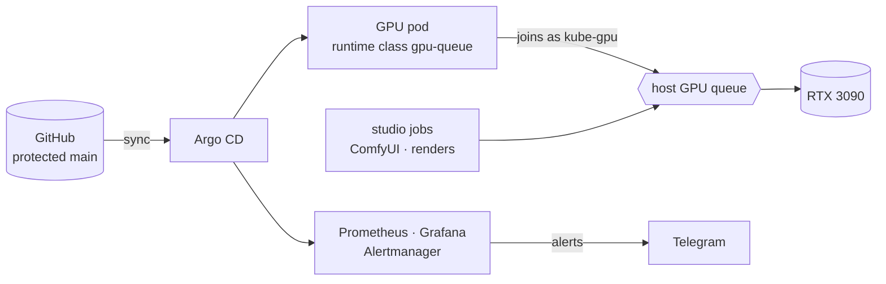

# gpu-platform

[](https://github.com/vbuyan/gpu-platform/actions/workflows/ci.yml)
[](https://github.com/vbuyan/gpu-platform/actions/workflows/image.yml)

A Kubernetes platform built on a workstation that was already in production: one RTX 3090 shared by
two teams through a custom GPU queue, ComfyUI and Ollama servers, Blender renders and video pipelines.
The cluster had to fit next to all of that without slowing anyone down, and without ever going
around the GPU queue.

**[Architecture](docs/architecture.md)** · **[Decisions (13 ADRs)](docs/decisions.md)** ·
**[Postmortems](docs/postmortems/)** · **[Build log](docs/build-log.md)**

## Highlights

- **Full kubeadm cluster on a shared, remote host.** Kubernetes 1.37, containerd, Cilium. The whole
  cluster is capped at 6.5 GiB of a 31 GiB machine, runs all the time, and is the first thing to give
  memory back under pressure. Installs arm a dead man's switch: a broken install rolls itself back.
- **GPU pods take turns in the host's existing queue instead of a device plugin.** A pod joins the same
  dispatcher the studio uses, as its own participant. Live test: it waited 927 s behind a Blender render,
  ran an fp16 benchmark at 66 TFLOPS and handed the card on 2 s after exiting. An admission policy in
  CEL makes it impossible to create a GPU pod that skips the queue (10 bypass cases tested in CI).
- **GitOps end to end.** Argo CD (app of apps) applies everything from this repo and upgrades itself.
  Terraform covers the two things Argo CD cannot: its own bootstrap and the GitHub repository.
- **Monitoring that respects the GPU.** Prometheus, Grafana and Telegram alerts tuned to this host's
  history; GPU and queue metrics come from what the queue already publishes, never from NVML.
- **CI that has caught real problems:** a vulnerable base image (Trivy), 14 shell bugs in code that
  already ran in production, and every chart validated as rendered.
- **Three written postmortems**, including a 5.5-hour disk-pressure eviction storm found by accident,
  which is why there are now alerts for it.

## Architecture in one picture



More in [docs/architecture.md](docs/architecture.md): every layer, the GPU job sequence, failure modes.

## Constraints

| Constraint | How the platform handles it |
|---|---|
| RAM is the bottleneck (31 GiB, often 25 GiB used) | The whole cluster lives in one cgroup capped at ~6.5 GiB |
| Two teams share the host | The cluster runs all the time but yields first: eviction at 4 / 2 GiB RAM, oomd kills it before studio jobs (ADR-011) |
| One GPU shared through an existing queue | GPU pods acquire the card through the same queue, never around it (ADR-009) |
| Remote host, reached only over Tailscale | Installs arm a dead man's switch that rolls everything back unless confirmed (ADR-005) |
| Host swap must stay on | kubelet `failSwapOn: false`, `swapBehavior: NoSwap` (ADR-004) |
| Host firewall blocks the home LAN | Tagged firewall exceptions for cluster ranges; pods still cannot reach the LAN (ADR-007) |
| Disk shared with the studio, ~95 % full | Absolute 20 GiB eviction floor, alerts on node pressure and evictions (ADR-011) |

## How this maps to production

This runs on one workstation with a consumer GPU because that is the hardware there is. The problems
are the same ones a company has with a GPU fleet: several teams, expensive cards, a fair queue,
nothing allowed to starve anything else. The table shows which piece here plays which role, what
it would be on a managed cloud cluster, and why it is different here.

| Here | On EKS / GKE / AKS | Why it differs here |
|---|---|---|
| kubeadm on one node | Managed control plane (EKS), node groups | One machine, no cloud budget; kubeadm also shows what a managed service hides (ADR-001) |
| GPU via CDI + RuntimeClass `gpu-queue`, no device plugin | NVIDIA GPU Operator: driver, device plugin, `nvidia.com/gpu` resource | The card is also used by programs outside the cluster, so the scheduler cannot own it (ADR-009) |
| Shared host queue (`turn`), background and urgent jobs | Kueue, Volcano or Run:ai: queues, priorities, fair share | The queue already existed for the studio; pods join it instead of competing with it |
| Whole job holds the card for its turn | MIG slices (A100/H100) or time-slicing | Consumer cards have no MIG; one job at a time is the honest model for a 24 GB card |
| ValidatingAdmissionPolicy `gpu-through-queue` | Same, or Kyverno / OPA Gatekeeper | Same idea: a GPU pod that skips the queue is rejected at admission |
| One cgroup cap, eviction thresholds, oomd | Dedicated GPU node pools, taints, requests and limits, Karpenter | Here the cluster shares a host with production work, so it must yield first (ADR-002, ADR-011) |
| Textfile exporter reading the queue state | DCGM exporter for GPU metrics, Kueue metrics for queues | No NVML calls from pods, so monitoring can never hold the card (ADR-010) |
| Prometheus + Grafana + Alertmanager to Telegram | Same stack, or Amazon Managed Prometheus / Grafana, alerts to PagerDuty or Slack | Same tools, smaller retention |
| Argo CD app of apps | Same | Same |
| Terraform: Argo CD bootstrap + GitHub repo, state in a Kubernetes Secret | Terraform for VPC, EKS, IAM, node groups; state in S3 with locking | Nothing to provision in a cloud; state lives in the cluster it manages (ADR-012) |
| Static local PVs for models and media | EBS / EFS CSI, models in S3 or a model registry | Single node, data already on its disk |
| Images on GHCR, scanned by Trivy in CI | ECR with scan on push, same Trivy gate | Same gate |
| Tailscale + dead man's switch for remote changes | Bastion or SSM, change windows, managed upgrades | One remote host with nobody next to it (ADR-005) |

The parts that would carry over unchanged: the GitOps layout, the admission policy, the alert rules,
the CI pipeline and the CronJob. The parts that would be replaced by managed services: the control
plane, the GPU access layer and the queue.

## Roadmap

| Stage | What | Status |
|---|---|---|
| 1 | kubeadm cluster: containerd, Cilium, memory cap, auto-rollback | done |
| 2 | GitOps: Argo CD app of apps, quotas, network policy | done |
| 3 | GPU through the shared queue: CDI, RuntimeClass, admission policy | done |
| 4 | Workloads: nightly Whisper subtitles as a CronJob through the queue (ADR-013) | done |
| 5 | Observability: Prometheus, Grafana, GPU-queue exporter, Telegram alerts | done |
| 6 | CI: linters, unit tests, kubeconform, admission tests on kind; image scanned and pushed to GHCR | done |
| 7 | Terraform: Argo CD bootstrap and the GitHub repository, state in the cluster | done |
| 8 | Write-ups: architecture, 13 ADRs, 3 postmortems, production mapping, build log | done |

## Layout

```
bootstrap/   host install: kubeadm cluster, GPU access, always-on mode (each with --rollback)
bin/         k8s on|off|status, set-repo-url, make-alert-secret
gitops/      Argo CD app of apps: root-app.yaml -> apps/ -> platform/, monitoring/
gpu-queue/   turn: entrypoint of GPU pods, waits for the host GPU queue
examples/    gpu-smoke-job.yaml: fp16 matmul benchmark through the queue
terraform/   cluster (Argo CD bootstrap, root app) and github (repository, branch protection)
images/      Dockerfile of the GPU-queue exporter
tests/       unit tests (exporter, queue wrapper) and the admission policy check
ci/          validate-manifests.sh: render every chart with the repo values, validate with kubeconform
docs/        architecture, decisions, postmortems, build log
```

## Install

```bash
sudo bash bootstrap/install-kubernetes.sh            # ~10 min, arms a 20-min auto-rollback
sudo bash bootstrap/install-kubernetes.sh --confirm  # after checking SSH still works
bash bootstrap/install-argocd.sh                     # or: terraform -chdir=terraform/cluster apply
sudo bash bootstrap/install-gpu-access.sh            # GPU for pods through the host queue
sudo bash bootstrap/install-always-on.sh             # start at boot, yield memory first
```
