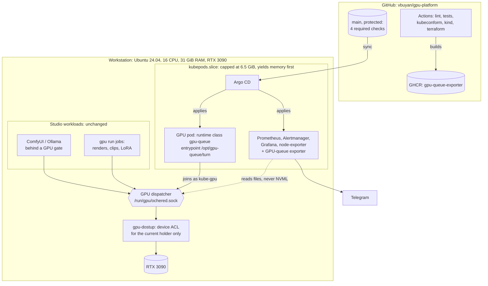
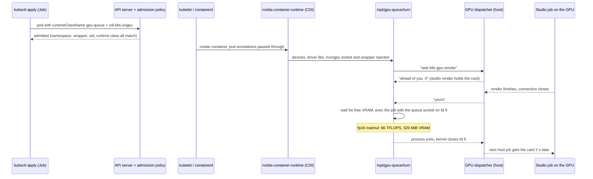

# Architecture

One workstation, two teams, one GPU. The host keeps doing its production work (ComfyUI and Ollama
behind a GPU queue, Blender renders, video pipelines). The cluster lives next to it under hard
limits and treats the host's existing services as the source of truth for the GPU.

## The host and the cluster

## Layers

| Layer | What | Why this way |
|---|---|---|
| Install | kubeadm 1.37, containerd 2.2, Cilium 1.20 (kube-proxy kept), dead man's switch | Real control plane like at work and on the CKA; a remote host must heal itself if an install cuts access (ADR-001, 005, 006) |
| Memory | `systemReserved: 24Gi` caps every pod, the control plane included, at ~6.5 GiB; eviction at 4 / 2 GiB available; oomd watches the cluster at 20 % pressure vs 50 % for the studio | The cluster can never take the host down, and under pressure it is the first to go (ADR-002, 011) |
| GitOps | Argo CD app of apps from `gitops/`; Argo CD manages its own upgrades | One `kubectl apply` by hand, everything else from Git (ADR-008) |
| GPU | No device plugin. CDI devices + RuntimeClass `gpu-queue`; the pod's entrypoint joins the host queue and keeps the connection open while it runs | Kubernetes cannot see the studio's GPU use; the existing queue is the right arbiter (ADR-009) |
| Policy | ValidatingAdmissionPolicy in CEL: GPU only in `jobs`, one container, wrapper first, uid 2950, runtime class required; Pod Security `restricted` in `jobs` | A GPU pod that skips the queue cannot be created; 10 bypass cases are tested in CI |
| Network | Cilium; NetworkPolicy keeps `jobs` off the LAN, the tailnet and other namespaces; tagged host-firewall exceptions | The host must stay invisible to the home network (ADR-007) |
| Observability | kube-prometheus-stack, a textfile exporter for the GPU and the queue, 12 alert rules tuned to this host, Telegram | DCGM would open NVML as root and break the queue's device guard (ADR-010) |
| CI/CD | shellcheck, yamllint, pytest, kubeconform on rendered charts, admission tests on kind, Terraform checks; image built, scanned with Trivy, pushed to GHCR | What runs in production is what was tested |
| IaC | Terraform for the Argo CD bootstrap and the GitHub repository; state in the cluster | The two things Argo CD cannot manage for itself (ADR-012) |

## A GPU job, step by step

## Failure modes and what happens

| Failure | Effect | Handled by |
|---|---|---|
| Host short of RAM | Cluster pods evicted at 4 / 2 GiB; oomd kills cluster before studio | ADR-011, `StationMemoryLow` alert |
| Root disk nearly full | Pods evicted under 20 GiB free; host alerts under 5 % / 40 GiB | ADR-011, postmortem 2026-11-15 |
| GPU dispatcher restarts | Waiting GPU pods exit with a clear message; the Job's backoff decides | `turn`, tests in `tests/test_turn.py` |
| Device guard stops updating | GPU metrics go stale | `GPUSnapshotStale` alert |
| Someone edits the cluster by hand | Argo CD reverts it | `selfHeal: true` |
| Git and cluster drift | `ArgoAppNotHealthy` after 15 min | Alert |
| Bad install over the remote link | Auto-rollback in 20 or 45 min unless confirmed | Dead man's switch, postmortem 2026-11-14 |

## Known limits

- One node. High availability is out of scope; the goal is safe co-existence with the host.
- Kubernetes does not count or queue GPUs itself; a GPU pod holds its CPU and memory requests while
  it waits in the host queue.
- The exporter image is built and scanned, but the cluster still runs the script from a ConfigMap on
  the public Python image; moving it to the GHCR image needs a pull secret or a public package.
